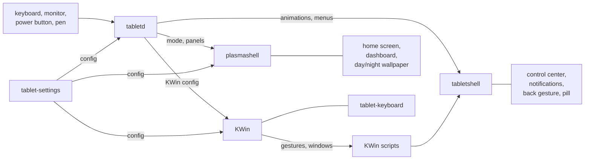

<div align="center">

# tablet-shell

**An iPadOS-style tablet shell for KDE Plasma 6 on Arch Linux**

Turns Plasma into a touch-first system and back into a normal desktop the moment a keyboard is attached.

[Русская версия](README.ru.md) · [Install](#install) · [Guides](#guides) · [Screenshots](#tour)


</div>

---

## Why

Plasma runs well on cheap Windows tablets, but it is a desktop: small targets, window frames, a
taskbar, a keyboard you have to summon by hand. tablet-shell keeps everything Plasma can do and puts a
tablet on top of it: an app grid with folders and widgets, edge gestures, a control center, its own
on-screen keyboard, lock and login screens in the same style. Attach the keyboard and it becomes a
desktop again; plug in a monitor and the tablet turns into a dashboard next to it.

It was built on (and for) a **Lenovo ThinkPad 10** — Atom Z3795, 4 GB RAM, eMMC — so it is written to
stay light: the background parts are small C++ programs, the UI is QML, nothing runs in Python.

## Features

| | |
| --- | --- |
| 🏠 **Home screen** | App pages, folders, widgets, a *Today* page (weather, calendar, news, exchange rates, sky, week in review), live weather on the wallpaper |
| 🔀 **Four modes** | Tablet, PC, dock (external monitor + dashboard), plus typewriter and reading modes — switched automatically, with an animation |
| 👆 **Gestures** | Control center from the top edge, notifications from the right, *back* from the left, iPhone-style home bar at the bottom |
| ⌨️ **Keyboard** | Own Wayland input method: Russian/English, flicks for symbols, split mode, emoji, space-bar trackpad, key clicks; hides when a real keyboard is attached |
| 🔒 **Lock & login** | One look for both, now-playing card, notifications; own greetd greeter |
| ⚙️ **Settings** | One app instead of System Settings: all KDE modules plus the shell's own sections |
| ✍️ **Typewriter** | Distraction-free screenplay writing in Markdown, daily goal, scenes, versions, export to PDF / DOCX / EPUB |
| 🖊️ **Pen** | Palm rejection, quick note from the corner, a tool ring (note, screenshot, magnifier, color picker, recording) |
| 📊 **Dashboard** | StandBy-style clock and system widgets on the built-in screen when docked |
| 🌗 **Light & dark** | Follows the time of day; cards, menus and sheets adapt |
| 🌍 **Russian & English** | Follows the Plasma language |
| 🧩 **More** | Web apps, Split View, Slide Over, picture-in-picture, screen time, storage cleanup, system snapshots, Android apps (Waydroid) |

---

## Tour

### Modes

The shell watches the hardware and picks the mode by itself: no keyboard → **tablet**, keyboard or
keyboard dock → **PC**, keyboard + external monitor → **dock**. Each change plays a short animation.

<table>
<tr>
<td width="50%"><br><b>Tablet</b> — app grid, floating dock, status bar, full-screen apps without frames</td>
<td width="50%"><br><b>PC</b> — icons in columns, one taskbar, window frames, double click</td>
</tr>
<tr>
<td colspan="2"><br><b>Dock</b> — the desktop moves to the external monitor, the tablet becomes a dashboard</td>
</tr>
<tr>
<td><br><b>Typewriter</b> — the editor, a pill with words, time, battery and clock, scenes at hand</td>
<td><br><b>Reading</b> — warm screen, dimmer, no notifications, Firefox reader view</td>
</tr>
</table>

<details>
<summary>Mode change animations</summary>

| To tablet | To PC | To dock | Typewriter | Reading |
| --- | --- | --- | --- | --- |
|  |  |  |  |  |

</details>

### Home screen and Today

<table>
<tr>
<td width="50%"><br>Swipe right for <b>Today</b>: weather, calendar, typewriter goal, sky…</td>
<td width="50%"><br>…Linux news, exchange rates, on this day, week in review, a quick note</td>
</tr>
</table>

### Control center, notifications, screen time

<table>
<tr>
<td width="33%"><br><b>Control center</b> — swipe down from the top</td>
<td width="33%"><br><b>Notifications</b> — swipe in from the right</td>
<td width="33%"><br><b>Screen time</b> — per day and per app</td>
</tr>
</table>

### Keyboard, lock screen, power menu

<table>
<tr>
<td width="33%"><br><b>Keyboard</b> — Russian with ё and ъ, symbols by flicking down</td>
<td width="33%"><br><b>Lock and login screen</b> — swipe up</td>
<td width="33%"><br><b>Power menu</b> — hold the power button</td>
</tr>
</table>

### Settings, dashboard, dark theme

<table>
<tr>
<td width="50%"><br><b>Settings</b> — the shell's sections and every KDE module in one app</td>
<td width="50%"><br><b>Dashboard</b> on the built-in screen when docked</td>
</tr>
<tr>
<td><br>Dark theme — Today</td>
<td><br>Dark theme — control center</td>
</tr>
</table>

---

## Install

### Requirements

- **Arch Linux** with **KDE Plasma 6** in a **Wayland** session
- a touch screen (pen optional); 4 GB RAM is enough
- optional system parts need: a btrfs root in subvolume `@` and systemd-boot with a unified kernel
  image (snapshots, boot splash); a kernel with binder (Android)

### Steps

```sh
git clone https://github.com/Vorsente/tablet-shell
cd tablet-shell
./install.sh                    # weather city = your time zone's; or: ./install.sh --city Berlin
```

The installer:

1. checks the system and offers to install the missing packages (`sudo pacman -S …`);
2. builds the C++ programs (about 10 minutes on an Atom, a minute on a laptop);
3. installs everything for your user in `~/.local` — nothing outside your home;
4. downloads the WhiteSur themes, icons and wallpapers and adjusts them;
5. sets the KDE options the shell needs and starts its services.

**Log out and back in.** That's it — the tablet is ready.

### Optional system parts

These change the system, so they are separate and run with `sudo`. The installer prints the list
with full paths (they are copied to `~/.local/share/tablet-shell/system/`).

| Script | What it does | Undo |
| --- | --- | --- |
| `system/devices.sh` | lets the user at the seat read the power/Windows buttons, pen and keyboards (power button menu, palm rejection, typewriter sounds); installs Rnote and Xournal++ | `--undo` |
| `system/settings-wrappers.sh` | Plasma's "Configure…" links open the tablet Settings app | `--undo` |
| `system/greeter.sh` | own login screen (greetd + cage) that looks like the lock screen | `--undo` |
| `system/language.sh ru` | system language and formats (any locale), Firefox language pack | run with `en` |
| `system/base.sh` | NetworkManager, Bluetooth, power profiles, compressed RAM swap (zram), smaller logs, touch apps | — |
| `system/recovery/install.sh` | a btrfs snapshot before every update, restore from Settings, a "before the last update" boot entry | — |
| `system/boot-splash/install.sh` | quiet boot with a splash showing the device name | `*.before-plymouth` files |
| `system/android/install.sh` | Android apps via Waydroid (`--gapps` for Google Play, `--houdini` / `--ndk` for ARM apps) | `pacman -R waydroid` |
| `system/cleanup.sh` | removes what the shell replaces and unused Plasma extras | — |

### Update and remove

```sh
git pull && ./install.sh        # update (your settings stay)
./uninstall.sh                  # back to the standard Plasma desktop; your files stay
```

---

## Guides

### Gestures and buttons

| Where | Gesture | Does |
| --- | --- | --- |
| top edge | swipe down | control center |
| right edge | swipe in | notification center |
| left edge | swipe in | back |
| bottom edge | swipe up / swipe up and hold | home / running apps |
| home screen | swipe right | Today page |
| home screen | swipe down | search (KRunner) |
| home screen | long press an icon | edit: drag, drop onto another icon to make a folder, "−" to remove |
| home screen | long press empty space | wallpaper, edit screen, add web app, light / dark / auto |
| power button | tap / hold | lock and switch the screen off (tap again to wake) / power menu |
| Windows button | press | Claude Desktop if installed, otherwise the app menu |
| pen button | hold above the screen | tool ring |
| pen | swipe from the bottom-right corner | quick note |

Keyboard shortcuts: <kbd>Meta</kbd>+<kbd>S</kbd> Split View · <kbd>Meta</kbd>+<kbd>O</kbd> Slide Over ·
<kbd>Meta</kbd>+<kbd>Shift</kbd>+<kbd>O</kbd> back to full screen · <kbd>Meta</kbd>+<kbd>P</kbd> picture-in-picture ·
<kbd>Meta</kbd>+<kbd>Shift</kbd>+<kbd>P</kbd> next corner.

### On-screen keyboard

- **Flick a key down** for its grey symbol; **hold** for alternatives (е → ё, ь → ъ, accents, «»).
- **Hold the space bar** and move the finger: the cursor follows. **Swipe across** it to switch language.
- **Double space** types ". "; **double-tap shift** for caps lock (green light).
- **Spread two fingers** to split the keyboard, pinch to join; **hold the globe** for the menu.
- Height, key shape, sounds and every gesture can be changed in *Settings → Keyboard*.

### Typewriter

1. Open **Typewriter** from the home screen (or say *Write* when the shell offers it after you attach
   a keyboard). The latest screenplay opens full screen, black on white; the screen dims and the
   tablet switches to power saving.
2. Write in Markdown: `## 1. INT. ROOM — NIGHT` starts a scene, `**NAME**` a character,
   `*(quietly)*` a parenthetical, `> line` dialogue. A new screenplay starts from a template.
3. The pill in the corner shows words written today against your goal, reading time, battery, clock.
   Its ☰ button opens **scenes** (tap to jump), **statistics**, **versions** (a snapshot every five
   minutes — open any as a copy) and **export** to PDF, DOCX or EPUB in standard manuscript format.
4. Close the editor (or the × on the pill): brightness, power profile and effects come back.

Screenplays live in `~/Сценарии` or `~/Screenplays` (set in `typewriterrc`).

### Home screen and widgets

- *Edit Home Screen* (long press on empty space) → **+ Widget**: weather, calendar, battery,
  typewriter, screen time, YouTube, news, exchange rates, Claude limits, on this day, sky.
- On the Today page tap **Edit** to reorder (↑ ↓), remove (−) or add widgets.
- **Web apps**: long press → *Web app*, give an address: the site gets its own icon and window.

### Dock mode and dashboard

Plug in a monitor while the keyboard is attached: windows move to the monitor, the built-in screen
shows the dashboard. Pick its widgets in *Settings → Dashboard*. If you dock for the first time after
installing, run `./install.sh --containments` once so the built-in screen gets the dashboard.

### Snapshots and recovery

With `system/recovery/install.sh` a snapshot of the system (not your files) is taken before every
package update. *Settings → Recovery* lists them, creates new ones and restores. If an update breaks
booting, hold **Space** while powering on and choose *before the last update*.

### Troubleshooting

| Problem | Fix |
| --- | --- |
| Something looks half-applied after installing | log out and back in |
| The keyboard does not appear | *Settings → Keyboard*: is a physical keyboard attached? Turn off *Hide when a physical keyboard is attached* |
| The power button only suspends | run `sudo system/devices.sh`, then log in again |
| Stuck at the login screen | <kbd>Ctrl</kbd>+<kbd>Alt</kbd>+<kbd>F2</kbd>, log in, `sudo ~/.local/share/tablet-shell/system/greeter.sh --undo` |
| The lock screen does not take the password | <kbd>Ctrl</kbd>+<kbd>Alt</kbd>+<kbd>F2</kbd>, log in, `loginctl unlock-sessions` |
| Logs | `journalctl --user -u tabletd -u tabletshell -u plasma-plasmashell` |

---

## How it works



| Part | What it is |
| --- | --- |
| `src/tabletd` | daemon: modes, keyboard/monitor detection, power and Windows buttons, pen, cleanup; `tablet-tools` (web apps, wallpapers, dashboard data, typewriter export) |
| `src/tabletshell` | layer-shell overlays: control center, notifications, screen time, back gesture, mode animations, power menu, charging, typewriter pill |
| `src/tablet-settings` | the Settings app (Kirigami), embeds every KDE settings module |
| `src/tablet-keyboard` | the on-screen keyboard (Wayland input method) |
| `src/tablet-greeter` | login screen (greetd) and the shared lock screen surface |
| `shell/` | Plasma packages (home screen, dashboard, wallpaper, global themes), KWin scripts, panel layouts |
| `system/` | optional sudo parts |
| `i18n/` | translations: Russian is the source, `en.py` the English table |

Adding UI text: write it in Russian with `Tr.t("…")` (QML) or `T(QStringLiteral("…"))` (C++), add
the English line to `i18n/en.py`, rebuild.

## Hardware

Tested on the **Lenovo ThinkPad 10** (20C1, Atom Z3795, 4 GB, keyboard dock, ThinkPad Tablet Dock,
Wacom pen). On other devices the shell detects what is there — pen, Windows button, light sensor,
battery, the built-in screen's name, a physical keyboard — and hides what is not. Reports from other
tablets are very welcome.

## Credits

[WhiteSur](https://github.com/vinceliuice) theme, icons and wallpapers by vinceliuice (downloaded at
install time) · Plasma Mobile's task switcher (patched copy made at run time) ·
[waydroid_script](https://github.com/casualsnek/waydroid_script) · Inter and Cousine fonts ·
weather by [Open-Meteo](https://open-meteo.com).

## License

[GPL-3.0-or-later](LICENSE)
