<div align="center">

# tablet-shell

**Планшетная оболочка для KDE Plasma 6 на Arch Linux — в стиле iPadOS или Google Pixel (Material Design)**

Превращает Plasma в систему для касаний и обратно в обычный рабочий стол, как только подключена клавиатура.

[English version](README.md) · [Установка](#установка) · [Гайды](#гайды) · [Скриншоты](#обзор) · [Что нового](#что-нового)

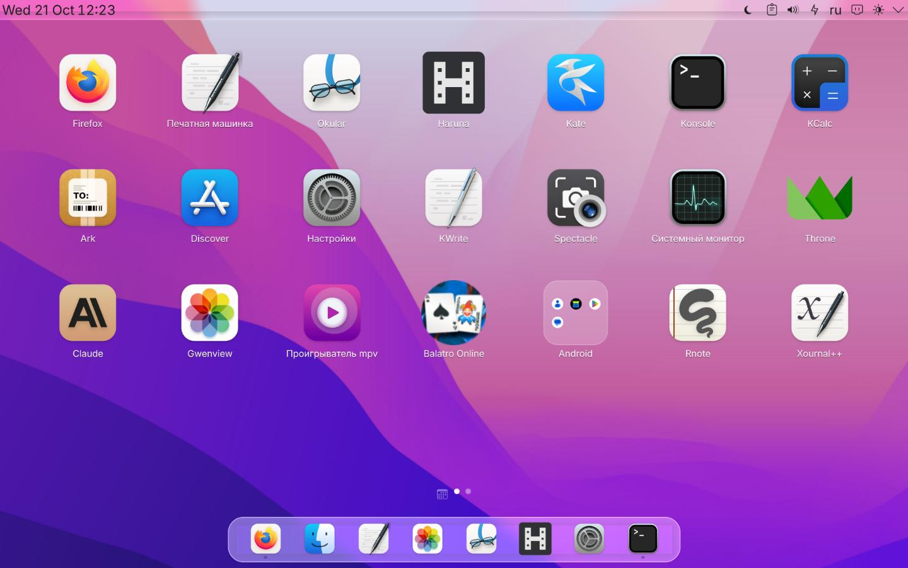

</div>

---

## Зачем

Plasma хорошо работает на недорогих Windows-планшетах, но это рабочий стол: мелкие кнопки, рамки
окон, панель задач, клавиатуру нужно вызывать руками. tablet-shell оставляет всё, что умеет
Plasma, и добавляет поверх планшет: сетку приложений с папками и виджетами, жесты от краёв, пункт
управления, свою экранную клавиатуру, экран блокировки и входа в том же стиле. Подключили
клавиатуру — снова рабочий стол; подключили монитор — планшет становится сводкой рядом с ним.
Вся оболочка бывает в двух видах — Apple / iPadOS или Google Pixel / Material Design, — они
переключаются одной настройкой.

Оболочка сделана на **Lenovo ThinkPad 10** (Atom Z3795, 4 ГБ, eMMC) и для него, поэтому она лёгкая:
фоновые части — небольшие программы на C++, интерфейс — на QML, ничего не работает на Python.

## Возможности

| | |
| --- | --- |
| 🏠 **Домашний экран** | Страницы приложений, папки, виджеты, страница *Сегодня* (погода, календарь, новости, курсы валют, небо, итоги недели), живая погода на обоях |
| 🔀 **Режимы** | Планшет, ПК, док-станция (внешний монитор + сводка), а также печатная машинка, режим чтения и режим кодинга — переключаются сами, с анимацией |
| 🎨 **Два стиля** | Apple / iPadOS (Liquid Glass) или Google Pixel / Material Design для всего сразу: домашний экран, виджеты, «Сегодня», панели, пункт управления, настройки, клавиатура, блокировка и вход, сводка |
| 👆 **Жесты** | Пункт управления сверху, уведомления справа, «назад» слева, полоска «домой» снизу, как на iPhone |
| ⌨️ **Клавиатура** | Свой метод ввода Wayland: русская и английская раскладки, символы смахиванием, разделённый режим, эмодзи, пробел как тачпад, звук клавиш; прячется, когда подключена настоящая |
| 🔒 **Блокировка и вход** | Один вид для обоих экранов, «Сейчас играет», уведомления; свой экран входа на greetd |
| ⚙️ **Настройки** | Одно приложение вместо «Параметров системы»: все модули KDE и разделы самой оболочки |
| ✍️ **Печатная машинка** | Сценарии в Markdown без отвлечений, цель на день, сцены, версии, экспорт в PDF / DOCX / EPUB |
| 🖊️ **Перо** | Игнорирование ладони, быстрая заметка из угла, кольцо инструментов (заметка, скриншот, Krita, пипетка, запись) |
| 📊 **Сводка** | Часы в стиле StandBy и системные виджеты на экране планшета в доке |
| 🌗 **Светлая и тёмная** | По времени суток; карточки, меню и панели подстраиваются |
| 🖼️ **Иконки** | Apple — тема MacTahoe (macOS 26). Material — Colloid и круглые адаптивные иконки. Приложениям без иконки в теме рисуются свои в том же стиле (`tablet-tools app-icons`, запускается сам при установке приложений) |
| 💻 **Режим кодинга** | LazyVim в полноэкранном терминале с отдельной конфигурацией и режимом фокуса, запуск одним нажатием из пункта управления |
| ⬆️ **Обновления** | Из «Настроек»: что нового, подтверждение, сборка, установка — настройки и темы сохраняются |
| 🌍 **Русский и английский** | По языку Plasma |
| 🧩 **И ещё** | Веб-приложения, Split View, Slide Over, картинка в картинке, экранное время, очистка, снимки системы, Android-приложения (Waydroid) |

---

## Обзор

### Режимы

Оболочка следит за железом и сама выбирает режим: нет клавиатуры — **планшет**, клавиатура или
док с клавиатурой — **ПК**, клавиатура и внешний монитор — **док-станция**. Каждая смена
сопровождается короткой анимацией.

<table>
<tr>
<td width="50%"><br><b>Планшет</b> — сетка приложений, плавающий док, строка состояния, приложения на весь экран без рамок</td>
<td width="50%">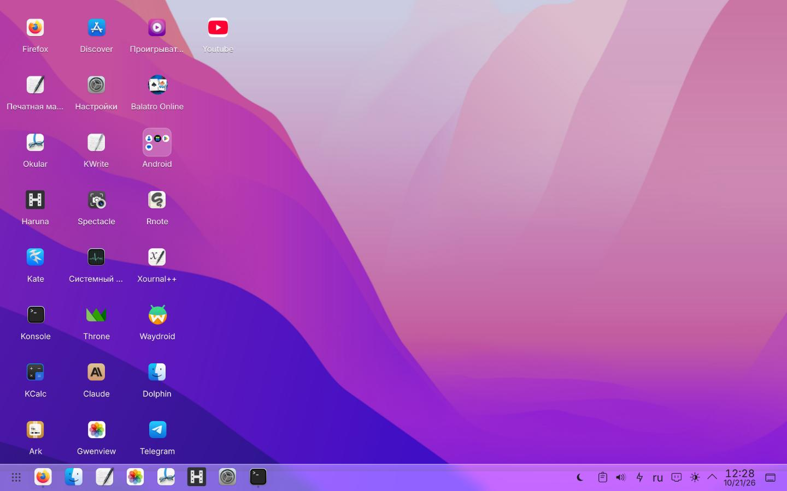<br><b>ПК</b> — значки столбцами, одна панель задач, рамки окон, двойной щелчок</td>
</tr>
<tr>
<td colspan="2">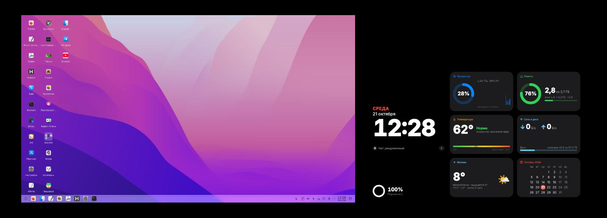<br><b>Док-станция</b> — рабочий стол переезжает на монитор, планшет показывает сводку</td>
</tr>
<tr>
<td><br><b>Печатная машинка</b> — редактор, «пилюля» со словами, временем, зарядом и часами, сцены под рукой</td>
<td>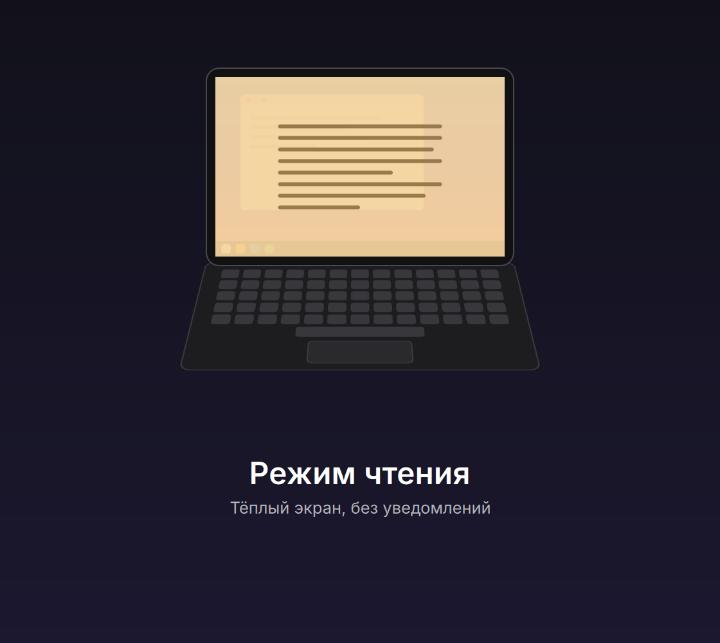<br><b>Чтение</b> — тёплый экран, ниже яркость, без уведомлений, режим чтения Firefox</td>
</tr>
</table>

<details>
<summary>Анимации смены режима</summary>

| В планшет | В ПК | В док-станцию | Печатная машинка | Чтение |
| --- | --- | --- | --- | --- |
| 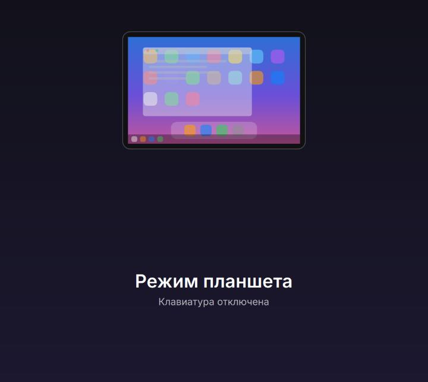 | 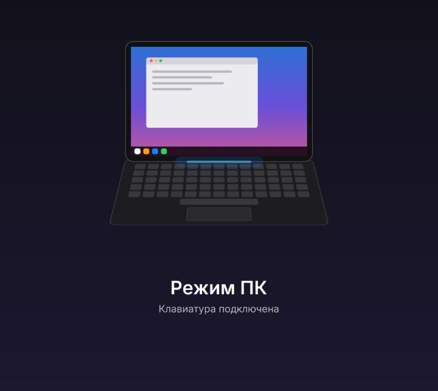 | 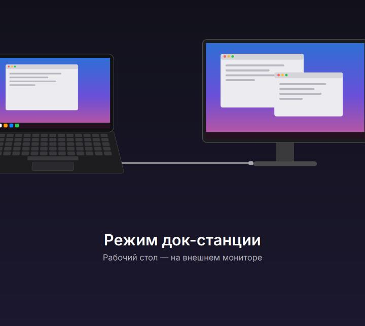 | 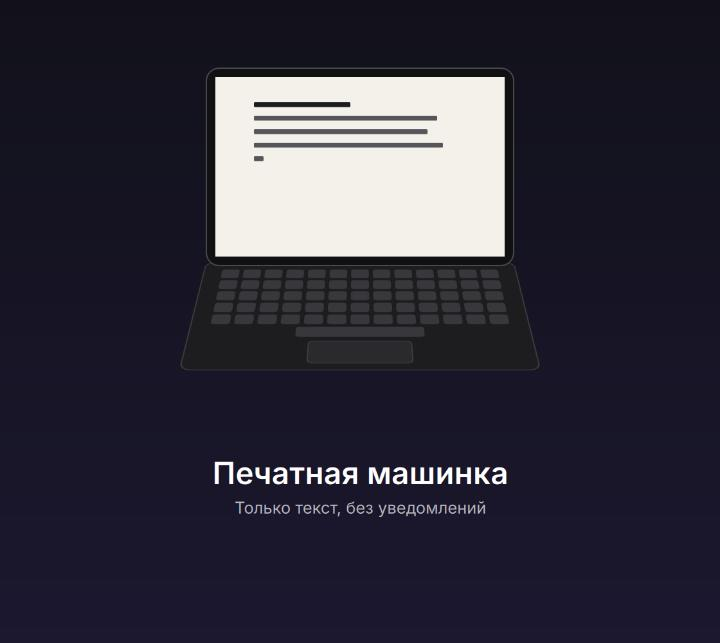 |  |

</details>

### Домашний экран и «Сегодня»

<table>
<tr>
<td width="50%">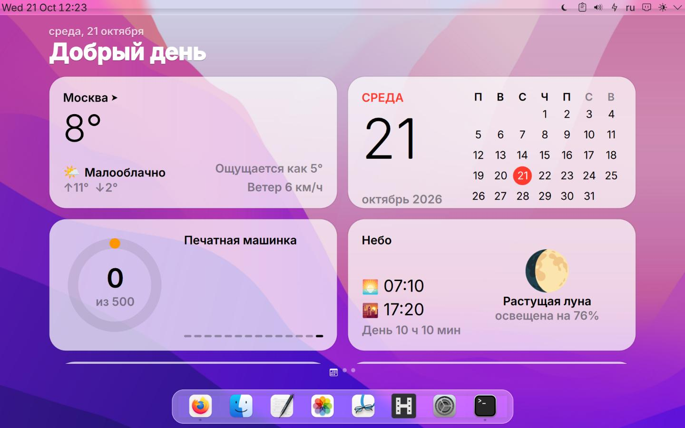<br>Смахните вправо — <b>Сегодня</b>: погода, календарь, цель печатной машинки, небо…</td>
<td width="50%"><br>…новости Linux, курсы валют, «в этот день», итоги недели, заметка</td>
</tr>
</table>

### Пункт управления, уведомления, экранное время

<table>
<tr>
<td width="33%">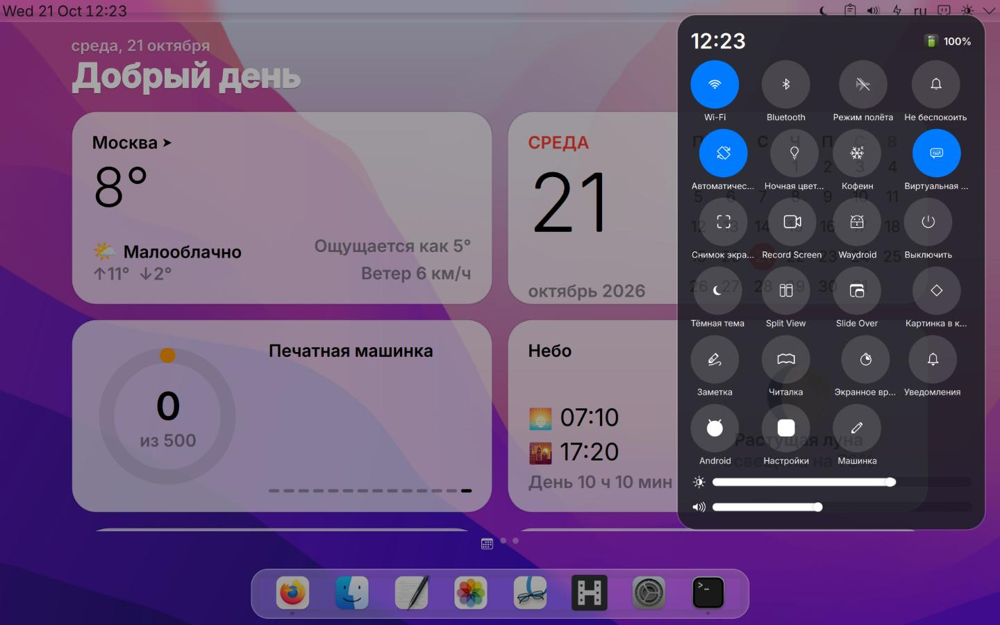<br><b>Пункт управления</b> — свайп вниз от верхнего края</td>
<td width="33%">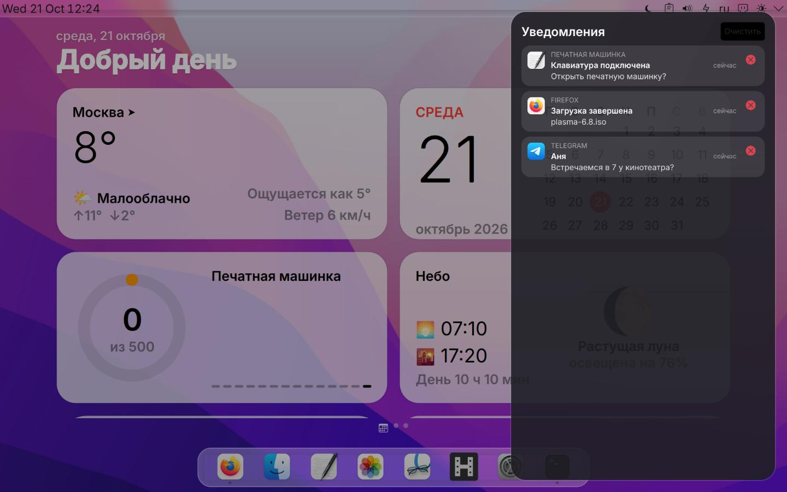<br><b>Уведомления</b> — свайп от правого края</td>
<td width="33%">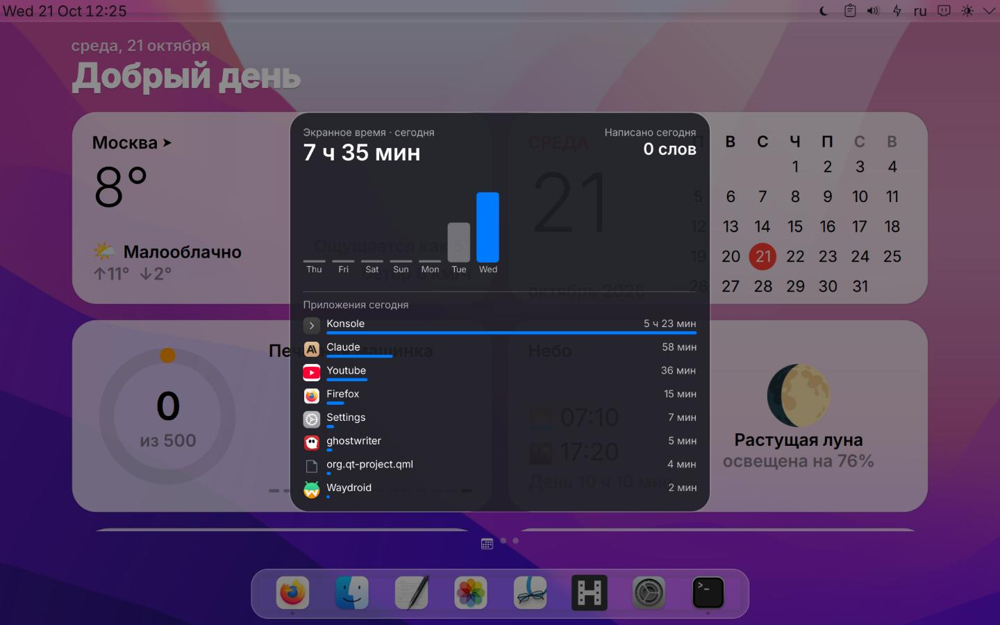<br><b>Экранное время</b> — по дням и приложениям</td>
</tr>
</table>

### Клавиатура, экран блокировки, меню питания

<table>
<tr>
<td width="33%"><br><b>Клавиатура</b> — с ё и ъ, символы смахиванием вниз</td>
<td width="33%">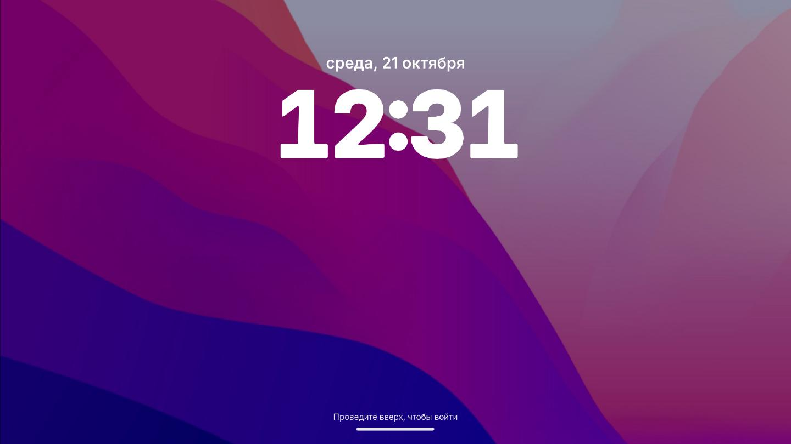<br><b>Экран блокировки и входа</b> — проведите вверх</td>
<td width="33%">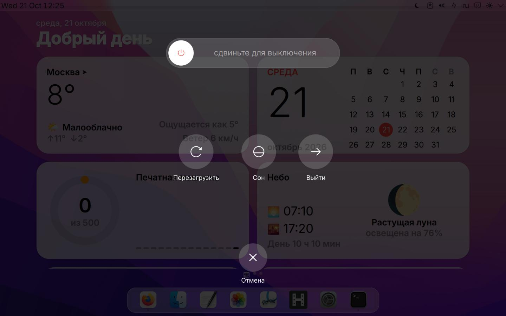<br><b>Меню питания</b> — удерживайте кнопку питания</td>
</tr>
</table>

### Настройки, сводка, тёмная тема

<table>
<tr>
<td width="50%">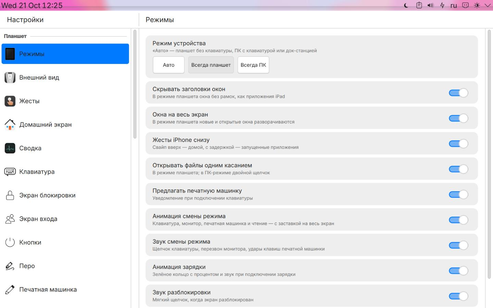<br><b>Настройки</b> — разделы оболочки и все модули KDE в одном приложении</td>
<td width="50%">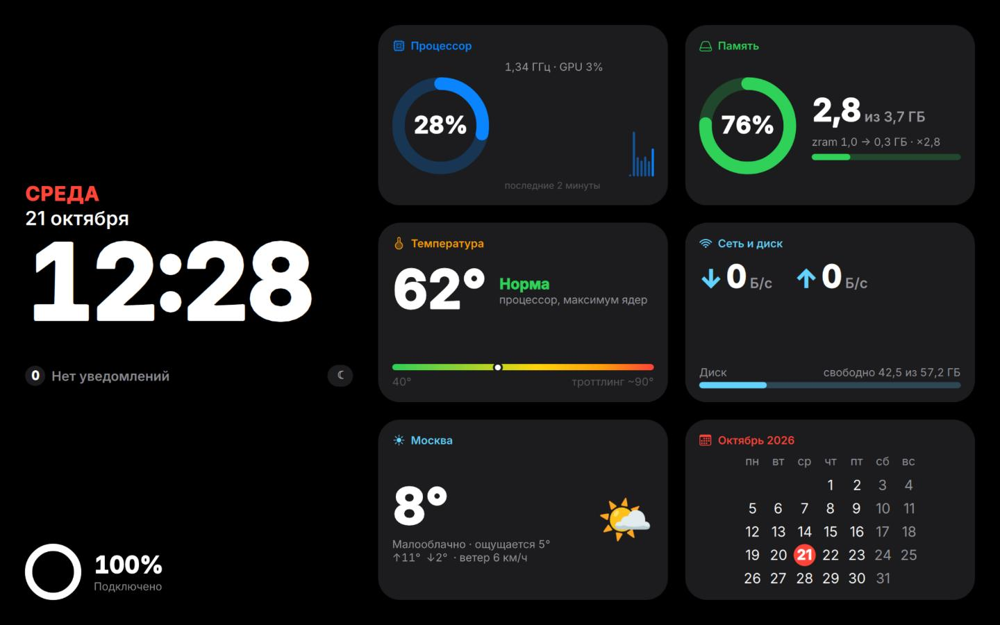<br><b>Сводка</b> на экране планшета в доке</td>
</tr>
<tr>
<td><br>Тёмная тема — «Сегодня»</td>
<td><br>Тёмная тема — пункт управления</td>
</tr>
</table>

---

## Установка

### Что нужно

- **Arch Linux** с **KDE Plasma 6** в сеансе **Wayland**
- сенсорный экран (перо по желанию); хватает 4 ГБ памяти
- для системных частей по желанию: корень на btrfs в подтоме `@` и systemd-boot с UKI (снимки,
  заставка загрузки); ядро с binder (Android)

### Шаги

```sh
git clone https://github.com/Vorsente/tablet-shell
cd tablet-shell
./install.sh                    # город для погоды — из часового пояса; или: ./install.sh --city Москва
# Для первого включения собственного экрана входа вместо SDDM:
# ./install.sh --install-greeter
```

Установщик:

1. проверяет систему и предлагает поставить недостающие пакеты (`sudo pacman -S …`);
2. собирает программы на C++ (около 10 минут на Atom, минута на ноутбуке);
3. ставит пользовательскую часть в `~/.local`; существующий экран входа tablet-shell может быть обновлён через `sudo`;
4. скачивает темы WhiteSur, значки MacTahoe и обои для стиля Apple, значки Colloid и шрифт Roboto Flex
   для стиля Material и подстраивает их (`--no-themes` оставляет текущие темы);
5. включает нужные оболочке настройки KDE, запускает службы и запрашивает восстановление панелей;
6. если экран входа tablet-shell уже установлен, автоматически обновляет его и отключает
   диагностический вывод `cage/libseat` (включая сообщения `seatd`) без создания файла журнала
   (может запросить пароль `sudo`).

Опция `--install-greeter` **явно** разрешает установку greetd вместо текущего менеджера входа.
Без неё установщик **не заменяет SDDM** или Plasma Login. Для обновления только пользовательской
части без запроса прав администратора используйте `--no-greeter-update`. Система не
изменяется без необходимости; пользовательские панели и закреплённые приложения сохраняются.

**Выйдите из сеанса и войдите снова.** Всё — планшет готов.

### Системные части (по желанию)

Они меняют систему, поэтому отдельные и запускаются через `sudo`. Установщик в конце выводит
список с полными путями (они копируются в `~/.local/share/tablet-shell/system/`).

| Скрипт | Что делает | Отмена |
| --- | --- | --- |
| `system/devices.sh` | даёт пользователю за планшетом доступ к кнопкам питания и Windows, перу и клавиатурам (меню питания, ладонь, звук печатной машинки); ставит Rnote и Xournal++ | `--undo` |
| `system/settings-wrappers.sh` | ссылки «Настроить…» в Plasma открывают «Настройки» планшета | `--undo` |
| `system/greeter.sh` | свой экран входа (greetd + cage), такой же, как экран блокировки; `--refresh` обновляет установленный экран | `--undo` |
| `system/language.sh ru` | язык и форматы системы (любая локаль), языковой пакет Firefox | запустить с `en` |
| `system/base.sh` | NetworkManager, Bluetooth, профили питания, сжатая подкачка в памяти (zram), приложения для касаний | — |
| `system/recovery/install.sh` | снимок btrfs перед каждым обновлением, восстановление из «Настроек», пункт загрузки «до последнего обновления» | — |
| `system/boot-splash/install.sh` | тихая загрузка с заставкой и названием устройства | файлы `*.before-plymouth` |
| `system/android/install.sh` | Android-приложения через Waydroid (`--gapps` — Google Play, `--houdini` / `--ndk` — ARM-приложения) | `pacman -R waydroid` |
| `system/cleanup.sh` | удаляет то, что заменила оболочка, и неиспользуемые дополнения Plasma | — |

### Обновление и удаление

`update.sh` собирает новую версию **до изменения установленной**, сохраняет резервные копии
конфигураций в `~/.local/state/tablet-shell/backup-*`, обновляет службы и панель, но **не
перезаписывает пользовательские настройки KDE, темы, город погоды и расположение панелей**.
Для установки из ZIP укажите новый архив через `--from`; не нужно распаковывать его поверх
старой папки. Отдельные системные службы Linux продолжают вести свои системные журналы.

Проще всего — **Настройки → Обновление**: там видно последний коммит на GitHub и что в нём нового.
После подтверждения скачивается именно этот коммит, архив проверяется, программы собираются до
замены установленных, и всё ставится в том же бережном режиме. Если установленная копия новее, чем
GitHub (например, собрана из локального ZIP), будет предупреждение. Экранная клавиатура, экран
блокировки и экран входа обновлениями не меняются — только через `./install.sh`; экран входа greetd
обновляется отдельно: `sudo ~/.local/share/tablet-shell/system/greeter.sh --refresh`. Файлы старых
версий удаляются, только если их поставил установщик и они не изменены.

```sh
./update.sh                    # Git: получить обновления и установить, сохраняя настройки
./update.sh --offline          # установить версию из текущей папки, не обращаясь к Git
./update.sh --from ./new.zip   # обновить установленную версию из нового ZIP-архива
./update.sh --no-greeter-update # обновить без sudo и без изменения экрана входа
./uninstall.sh                  # вернуть обычную Plasma; ваши файлы останутся
```

---

## Гайды

### Два стиля: Apple и Material

**Настройки → Внешний вид → Стиль всей оболочки**: *Apple / iPadOS* или *Google Pixel / Material
Design* (в терминале — `~/.local/bin/shell-style apple|pixel`). Пока Plasma меняет оформление, экран
закрыт занавесом; он открывается, когда всё перерисовано (около десяти секунд на Atom), поэтому
наполовину переключённого рабочего стола не видно.

| | Apple / iPadOS | Google Pixel / Material Design |
| --- | --- | --- |
| Поверхности | полупрозрачное стекло Liquid Glass с размытием | непрозрачные тональные карточки без размытия (легче для слабой графики) |
| Домашний экран | сетка iPad, папки — скруглённые квадраты, точки страниц | блок «Коротко» с датой и погодой, строка поиска, круглые папки 2×2, чёрточки страниц |
| Виджеты и «Сегодня» | виджеты iOS | виджеты Material: у каждого свой цвет, сетка календаря, прогресс-бары |
| Пункт управления | круглые кнопки, высокие ползунки | широкие плитки на подложке, горизонтальные ползунки |
| Иконки | MacTahoe | Colloid и круглые адаптивные иконки приложений |
| Шрифт | Inter | Roboto Flex (с кириллицей) |

Светлая / тёмная / автоматическая тема — отдельная настройка и работает с обоими стилями. Каждый
стиль помнит свои обои. Выбор сохраняется при обновлениях.

### Жесты и кнопки

| Где | Жест | Что делает |
| --- | --- | --- |
| верхний край | свайп вниз | пункт управления |
| правый край | свайп внутрь | центр уведомлений |
| левый край | свайп внутрь | назад |
| нижний край | свайп вверх / вверх с задержкой | домой / запущенные приложения |
| домашний экран | свайп вправо | страница «Сегодня» |
| домашний экран | свайп вниз | поиск (KRunner) |
| домашний экран | долгое нажатие на значок | правка: перетащить, бросить на другой значок — папка, «−» — убрать |
| домашний экран | долгое нажатие на пустое место | обои, править экран, веб-приложение, светлая / тёмная / авто |
| кнопка питания | нажать / удерживать | заблокировать и погасить экран (ещё нажатие — включить) / меню питания |
| кнопка Windows | нажать | Claude Desktop, если установлен, иначе меню приложений |
| кнопка пера | удерживать над экраном | кольцо инструментов |
| перо | провести от правого нижнего угла | быстрая заметка |

Сочетания клавиш: <kbd>Meta</kbd>+<kbd>S</kbd> Split View (справа — предыдущее приложение, в том числе свёрнутое;
если других нет, правую половину займёт следующее открытое) · <kbd>Meta</kbd>+<kbd>Alt</kbd>+<kbd>S</kbd> граница
на 1/2, 2/3, 1/3 (или удержание плитки в пункте управления) · <kbd>Meta</kbd>+<kbd>Shift</kbd>+<kbd>S</kbd> поменять
окна местами · <kbd>Meta</kbd>+<kbd>O</kbd> Slide Over ·
<kbd>Meta</kbd>+<kbd>Shift</kbd>+<kbd>O</kbd> обратно на весь экран · <kbd>Meta</kbd>+<kbd>P</kbd> картинка в картинке ·
<kbd>Meta</kbd>+<kbd>Shift</kbd>+<kbd>P</kbd> следующий угол.

### Экранная клавиатура

- **Смахните клавишу вниз** — серый символ над буквой (он съезжает в клавишу вслед за пальцем);
  **удерживайте** — меню: сначала серый символ, затем варианты (е → ё, ь → ъ, акценты, «»; первый вариант
  виден в углу клавиши).
- **Удерживайте пробел** и ведите пальцем — курсор идёт следом. **Проведите по пробелу** — смена языка.
- **Два пробела** — «. »; **двойное нажатие Shift** — Caps Lock (зелёный огонёк).
- **Разведите два пальца** — клавиатура разделится, сведите — соединится; **удерживайте глобус** — меню.
- Высота, форма клавиш, звук и все жесты — в *Настройки → Клавиатура*.

### Печатная машинка

1. Откройте **Печатную машинку** с домашнего экрана (или нажмите *Писать*, когда оболочка предложит
   это после подключения клавиатуры). Откроется последний сценарий на весь экран, чёрным по
   белому; яркость снизится, планшет перейдёт в энергосбережение.
2. Пишите в Markdown: `## 1. ИНТ. КОМНАТА — НОЧЬ` — сцена, `**ИМЯ**` — персонаж, `*(тихо)*` —
   ремарка, `> реплика` — реплика. Новый сценарий начинается с шаблона.
3. «Пилюля» в углу показывает слова за сегодня и цель, хронометраж, заряд и часы. Кнопка ☰
   открывает **сцены** (касание — переход), **статистику**, **версии** (снимок каждые пять минут,
   любую можно открыть копией) и **экспорт** в PDF, DOCX или EPUB в стандартном сценарном оформлении.
4. Закройте редактор (или × на «пилюле») — яркость, профиль питания и эффекты вернутся.

Сценарии лежат в `~/Сценарии` (папку можно сменить в `typewriterrc`).

### Перо

Удерживайте кнопку пера над экраном — откроется кольцо инструментов: **заметка, скриншот, Krita,
пипетка, запись экрана**. Смахните пером из правого нижнего угла — быстрая заметка. Krita ставит
`./install.sh`.

### Режим кодинга

*Пункт управления → Кодинг* или *Настройки → Режим кодинга* открывает **LazyVim** в полноэкранном
Konsole с анимацией режима. Пока он открыт, уведомления придерживаются; после закрытия Konsole
возвращаются прежние яркость, профиль питания и эффекты. `./install.sh` ставит Neovim, ripgrep, fd,
fzf, lazygit, tree-sitter и шрифт JetBrains Mono Nerd Font и скачивает официальный
[LazyVim Starter](https://github.com/LazyVim/starter). Конфигурация лежит отдельно в
`~/.config/tablet-shell-lazyvim` (`NVIM_APPNAME`): ваш `~/.config/nvim` не трогается, а повторная
установка сохраняет ваши изменения LazyVim. Редактор открывает `~/Проекты` (с английским
интерфейсом — `~/Projects`), сам не создаёт файлов и не делает git-коммитов. Выход — `:qa`.

### Домашний экран и виджеты

- *Править экран «Домой»* (долгое нажатие на пустое место) → **+ Виджет**: погода, календарь,
  батарея, печатная машинка, экранное время, YouTube, новости, курсы валют, лимиты Claude, «в этот
  день», небо.
- На странице «Сегодня» нажмите **Изменить**: порядок (↑ ↓), убрать (−) или добавить.
- **Веб-приложения**: долгое нажатие → *Веб-приложение*, укажите адрес — у сайта появятся свой значок
  и окно.

### Док-станция и сводка

Подключите монитор при подключённой клавиатуре: окна переедут на монитор, экран планшета покажет
сводку. Её виджеты выбираются в *Настройки → Сводка*. Если подключаете док впервые после установки,
один раз запустите `./install.sh --containments`, чтобы экран планшета получил сводку.

### Слабые устройства

- *Настройки → Режимы → Менять масштаб при смене режима* по умолчанию выключено: смена масштаба
  KScreen надолго подвешивает слабую графику.
- *Настройки → Внешний вид → Анимированная погода на обоях* по умолчанию выключена; *Живые обои*
  (плавная смена дня и ночи) — отдельная и лёгкая настройка.
- В стиле Material нет размытия совсем — это легче для старой графики, чем Liquid Glass.
- `update.sh` хранит собранные программы в `~/.cache/tablet-shell/compiled` и использует `ccache`,
  если он есть, поэтому обновление, где поменялись только QML или иконки, занимает секунды.

### Снимки и восстановление

С `system/recovery/install.sh` перед каждым обновлением пакетов делается снимок системы (не ваших
файлов). *Настройки → Восстановление* показывает снимки, создаёт новые и восстанавливает. Если после
обновления система не загружается, удерживайте **пробел** при включении и выберите *до последнего
обновления*.

### Если что-то не так

| Проблема | Что делать |
| --- | --- |
| После установки что-то применилось наполовину | выйти из сеанса и войти снова |
| Не появляется клавиатура | *Настройки → Клавиатура*: подключена физическая? Выключите *Скрывать при физической клавиатуре* |
| Кнопка питания только усыпляет | `sudo system/devices.sh` и войти снова |
| Застрял на экране входа | <kbd>Ctrl</kbd>+<kbd>Alt</kbd>+<kbd>F2</kbd>, войти, `sudo ~/.local/share/tablet-shell/system/greeter.sh --undo` |
| Экран блокировки не принимает пароль | <kbd>Ctrl</kbd>+<kbd>Alt</kbd>+<kbd>F2</kbd>, войти, `loginctl unlock-sessions` |
| После смены стиля оформление применилось наполовину | ещё раз выполнить `~/.local/bin/shell-style pixel` (или `apple`); если пропала панель — выйти из сеанса и войти снова |
| Журналирование | Отключено у служб и приложений tablet-shell (`TABLET_SHELL_DEBUG=1` включает, сообщения идут в journal); системный journal не затрагивается |

---

## Как устроено

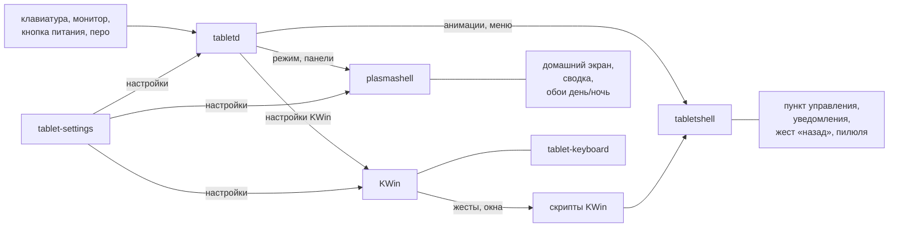

| Часть | Что это |
| --- | --- |
| `src/tabletd` | служба: режимы, клавиатура и монитор, кнопки питания и Windows, перо, очистка; `tablet-tools` (веб-приложения, обои, данные сводки, экспорт сценариев) |
| `src/tabletshell` | оверлеи: пункт управления, уведомления, экранное время, жест «назад», анимации режимов и смены стиля, меню питания, зарядка, «пилюля» |
| `src/tablet-settings` | приложение «Настройки» (Kirigami), встраивает все модули KDE |
| `src/tablet-keyboard` | экранная клавиатура (метод ввода Wayland) |
| `src/tablet-greeter` | экран входа (greetd) и общий вид экрана блокировки |
| `shell/` | пакеты Plasma (домашний экран, сводка, обои, глобальные темы обоих стилей), темы Plasma, цветовые схемы и значки Material, скрипты KWin, раскладки панелей |
| `bin/` | небольшие команды: `shell-style`, `coding-mode`, `typewriter`, `reading-mode`, обновление с GitHub… |
| `scripts/` | помощники установщика: темы, значки Material, LazyVim, генерация ресурсов Material |
| `tests/` | тесты на Node.js для установщика, обновления и смены стиля (`node --test tests/*.test.cjs`) |
| `system/` | системные части через sudo |
| `i18n/` | переводы: исходный язык — русский, `en.py` — таблица английского |

Новый текст интерфейса: пишите по-русски в `Tr.t("…")` (QML) или `T(QStringLiteral("…"))` (C++),
добавьте английскую строку в `i18n/en.py` и пересоберите.

## Железо

Проверено на **Lenovo ThinkPad 10** (20C1, Atom Z3795, 4 ГБ, клавиатура-док, ThinkPad Tablet Dock,
перо Wacom). На других устройствах оболочка сама находит перо, кнопку Windows, датчик освещённости,
батарею, имя встроенного экрана и физическую клавиатуру, а чего нет — прячет. Отчёты с других
планшетов очень пригодятся.

## Благодарности

Темы, значки и обои [WhiteSur, MacTahoe и Colloid](https://github.com/vinceliuice) от vinceliuice
(скачиваются при установке) · символьные значки Breeze (копируются в тему значков Material при
установке) · переключатель задач и быстрые настройки Plasma Mobile ·
[waydroid_script](https://github.com/casualsnek/waydroid_script) · шрифты Inter, Roboto Flex и Cousine ·
[LazyVim](https://www.lazyvim.org) · погода [Open-Meteo](https://open-meteo.com).

## Лицензия

[GPL-3.0-or-later](LICENSE)

## Что нового

**Октябрь 2026**

- **Стиль Material Design** для всей оболочки рядом со стилем iPadOS: свои темы Plasma, значки, обои,
  виджеты, страница «Сегодня», сводка, пункт управления, настройки и экран блокировки.
- **Смена стиля без мельканий:** занавес закрывает экран, пока Plasma не перерисуется.
- **Обновления из «Настроек»** со списком изменений и шагами установки; клавиатуру, экраны
  блокировки и входа обновления не трогают.
- **Режим кодинга** с LazyVim, кольцо инструментов пера с Krita и записью экрана.
- Исправления: пропадающая после входа панель, ползунки после смены стиля на лету, значки в виде
  квадратов, даты не на том языке, ложное предупреждение «GitHub старее».

Подробные заметки — в файлах `ИЗМЕНЕНИЯ-*.md` и `ИСПРАВЛЕНИЯ*.md`.
